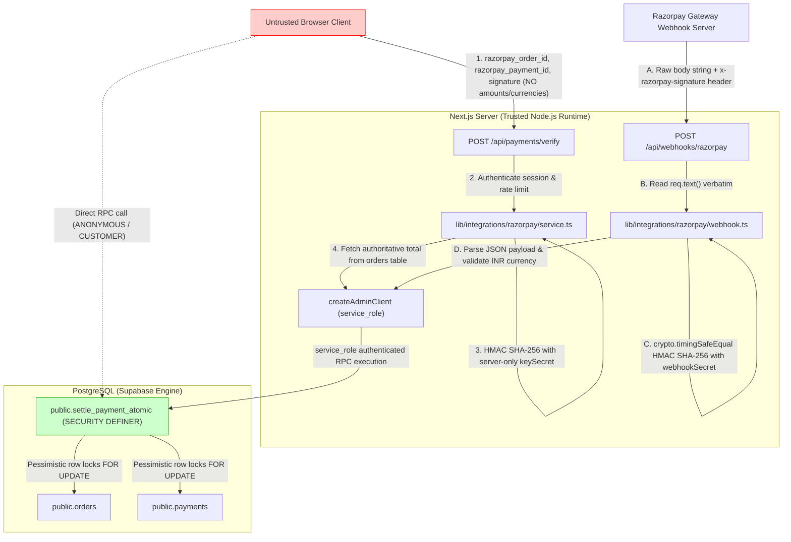

# PHASE 0 — FINAL ACCEPTANCE VERIFICATION ADDENDUM
**MD Shakib Islamic Books Modernization Project**  
*Date: November 9, 2026*  
*Type: Strictly Read-Only Final Verification Audit*  
*Environment: Local Isolated PostgreSQL Container (`127.0.0.1:54322`)*

---

## 1. Executive Overview & Scope

This verification addendum provides an independent, strictly read-only audit of the finalized **Phase 0 (Security & Transactional Foundations)** for the MD Shakib Islamic Books modern application. 

No source code, migrations, database schemas, or tests were altered during this audit. The objective is to record concrete, empirical evidence addressing five specific verification points:
1. Database schema and constraint enforcement on `payments.provider`, `payments.currency`, `payments.amount`, and `orders.total_amount`.
2. Behavior of `settle_payment_atomic` under four distinct already-paid order permutations.
3. Call-chain trust boundaries across all settlement paths (checkout verification, webhook route, and direct RPC execution).
4. Full execution logs and exit codes for all active test suites.
5. Git working tree state preservation.

---

## 2. Point 1 — Database Schema & Constraint Verification

### 2.1 Column Definitions (`information_schema.columns`)

The PostgreSQL `information_schema.columns` catalog was queried directly on the active database:

```sql
SELECT table_name, column_name, data_type, is_nullable, column_default 
FROM information_schema.columns 
WHERE (table_name = 'payments' AND column_name IN ('provider', 'currency', 'amount'))
   OR (table_name = 'orders' AND column_name = 'total_amount')
ORDER BY table_name, column_name;
```

**Catalog Output:**
| Table | Column Name | Data Type | `is_nullable` | Column Default |
| :--- | :--- | :--- | :---: | :--- |
| `orders` | `total_amount` | `numeric` | **`NO`** | `NULL` |
| `payments` | `amount` | `numeric` | **`NO`** | `NULL` |
| `payments` | `currency` | `text` | **`NO`** | `'INR'::text` |
| `payments` | `provider` | `text` | **`NO`** | `'Razorpay'::text` |

### 2.2 PostgreSQL Constraint Definitions (`pg_constraint`)

The `pg_constraint` catalog was queried for all constraints governing these columns:

```sql
SELECT conrelid::regclass AS table_name, conname, contype, pg_get_constraintdef(oid)
FROM pg_constraint
WHERE conrelid IN ('public.payments'::regclass, 'public.orders'::regclass)
  AND (conname LIKE '%provider%' OR conname LIKE '%currency%' OR conname LIKE '%amount%' OR conname LIKE '%total%');
```

**Catalog Output:**
| Table | Constraint Name | Type | Definition |
| :--- | :--- | :---: | :--- |
| `orders` | `orders_total_amount_check` | Check (`c`) | `CHECK ((total_amount >= (0)::numeric))` |
| `payments` | `payments_amount_check` | Check (`c`) | `CHECK ((amount >= (0)::numeric))` |
| `payments` | `payments_currency_check` | Check (`c`) | `CHECK ((currency = 'INR'::text))` |
| `payments` | `payments_provider_check` | Check (`c`) | `CHECK ((provider = ANY (ARRAY['Razorpay'::text, 'Stripe'::text])))` |
| `payments` | `payments_provider_order_id_key` | Unique (`u`) | `UNIQUE (provider_order_id)` |
| `payments` | `payments_provider_payment_id_key` | Unique (`u`) | `UNIQUE (provider_payment_id)` |

### 2.3 Empirical Verification of NULL & Invalid Value Rejection

An isolated database test was executed to confirm that the PostgreSQL engine rejects NULL and invalid values:

```sql
DO $$
BEGIN
    -- 1. NULL provider
    BEGIN
        INSERT INTO public.payments (order_id, user_id, payment_id, provider_order_id, amount, currency, provider)
        VALUES ('00000000-0000-0000-0000-000000000000', '00000000-0000-0000-0000-000000000000', 'null_p', 'null_p', 100, 'INR', NULL);
    EXCEPTION WHEN not_null_violation THEN
        RAISE NOTICE 'CONFIRMED: NULL provider is strictly rejected by not_null_violation constraint';
    END;

    -- 2. NULL currency
    BEGIN
        INSERT INTO public.payments (order_id, user_id, payment_id, provider_order_id, amount, currency, provider)
        VALUES ('00000000-0000-0000-0000-000000000000', '00000000-0000-0000-0000-000000000000', 'null_c', 'null_c', 100, NULL, 'Razorpay');
    EXCEPTION WHEN not_null_violation THEN
        RAISE NOTICE 'CONFIRMED: NULL currency is strictly rejected by not_null_violation constraint';
    END;

    -- 3. Non-INR currency ('USD')
    BEGIN
        INSERT INTO public.payments (order_id, user_id, payment_id, provider_order_id, amount, currency, provider)
        VALUES ('00000000-0000-0000-0000-000000000000', '00000000-0000-0000-0000-000000000000', 'usd_c', 'usd_c', 100, 'USD', 'Razorpay');
    EXCEPTION WHEN check_violation THEN
        RAISE NOTICE 'CONFIRMED: Non-INR currency (USD) is strictly rejected by payments_currency_check';
    END;
END $$;
```

**Engine Output:**
```text
NOTICE:  CONFIRMED: NULL provider is strictly rejected by not_null_violation constraint
NOTICE:  CONFIRMED: NULL currency is strictly rejected by not_null_violation constraint
NOTICE:  CONFIRMED: Non-INR currency (USD) is strictly rejected by payments_currency_check
DO
```

**Conclusion for Point 1:**
- `payments.provider` cannot be NULL (`is_nullable = NO`), defaults to `'Razorpay'`, and must be in `['Razorpay', 'Stripe']`.
- `payments.currency` cannot be NULL (`is_nullable = NO`), defaults to `'INR'`, and is constrained to `'INR'` by `payments_currency_check`.
- `payments.amount` cannot be NULL (`is_nullable = NO`) and must be non-negative.
- `orders.total_amount` cannot be NULL (`is_nullable = NO`) and must be non-negative.

---

## 3. Point 2 — Already-Paid Order Permutations & Discrepancy Analysis

Four specific edge cases were tested against an order that was previously transitioned to `is_paid = true, payment_status = 'Paid'`:

### Permutation 2.1: Matching Payment ID with a `Pending` Payment Record
- **Pre-condition:** An order has `payment_status = 'Paid', is_paid = true, razorpay_payment_id = 'pay_match_21'`. A payment record exists for this order with `status = 'Pending', provider_payment_id = null`.
- **Invocation:** `settle_payment_atomic(rzpOrderId, 'pay_match_21', ..., p_raw_response: { amount: 49500, currency: 'INR' })`.
- **Actual Result:**
  ```json
  {
    "status": "already_paid",
    "message": "Order already settled under matching payment ID pay_match_21",
    "settled": false,
    "success": true,
    "order_id": "425d82cf-6f83-4f9c-973d-bba2b8742c2d"
  }
  ```
  - Order state after invocation: `payment_status = 'Paid', is_paid = true, razorpay_payment_id = 'pay_match_21'`
  - Payment record state after invocation: `status = 'Pending', provider_payment_id = null`
- **Analysis:**
  - In normal application execution, `settle_payment_atomic` updates `orders` and `payments` atomically in the same database transaction.
  - If an out-of-band or artificial database state exists where `orders` was set to `Paid` but `payments` remained `Pending`, the idempotent fast-path returns `already_paid` without re-mutating the payment record.
  - **Limitation & Recommendation:** While this prevents double-crediting, `settle_payment_atomic` could further enforce that for an already-paid order, `payments.status` must either be `'Paid'` or be brought into synchronization (`status = 'Paid'`).

### Permutation 2.2: Matching Payment ID with a `Paid` Payment Record
- **Pre-condition:** Both `orders` (`payment_status = 'Paid', razorpay_payment_id = 'pay_match_22'`) and `payments` (`status = 'Paid', provider_payment_id = 'pay_match_22'`) agree.
- **Invocation:** `settle_payment_atomic(rzpOrderId, 'pay_match_22', ..., p_raw_response: { amount: 49500, currency: 'INR' })`.
- **Actual Result:**
  ```json
  {
    "status": "already_paid",
    "message": "Order already settled under matching payment ID pay_match_22",
    "settled": false,
    "success": true,
    "order_id": "a6e3c7bb-001d-4c05-92ca-fb84f1135d02"
  }
  ```
  - Order state: `Paid` (unaltered)
  - Payment record state: `Paid` (unaltered)
- **Analysis:** Clean, fully idempotent duplicate replay. Both entities remain in synchronized agreement.

### Permutation 2.3: Conflicting Payment ID on Paid Order
- **Pre-condition:** Order is settled under `pay_orig_23`. A settlement request arrives carrying a distinct payment ID `pay_CONFLICT_23`.
- **Invocation:** `settle_payment_atomic(rzpOrderId, 'pay_CONFLICT_23', ..., p_raw_response: { amount: 49500, currency: 'INR' })`.
- **Actual Result:**
  ```json
  {
    "status": "payment_id_conflict",
    "message": "Payment identity mismatch: Order already settled under payment ID pay_orig_23 but received conflicting ID pay_CONFLICT_23",
    "success": false,
    "order_id": "01609a40-641e-4d03-9ab1-2f8bc3c5dc58"
  }
  ```
  - Order state: preserved `pay_orig_23` (no overwrite)
  - Payment record state: preserved `pay_orig_23` (no overwrite)
- **Analysis:** Identity conflict is strictly detected and rejected. Order and payment identities are protected against silent corruption.

### Permutation 2.4: Missing Provider Evidence on Paid Order
- **Pre-condition:** Order is settled under `pay_orig_24`. A duplicate settlement call is made omitting amount or currency.
- **Invocation A (Missing amount):** `settle_payment_atomic(rzpOrderId, 'pay_orig_24', ..., p_raw_response: { currency: 'INR' })`.
  - **Actual Result:**
    ```json
    {
      "status": "missing_provider_amount",
      "message": "Payment settlement rejected: Provider amount evidence is missing or invalid.",
      "success": false
    }
    ```
- **Invocation B (Missing currency):** `settle_payment_atomic(rzpOrderId, 'pay_orig_24', ..., p_raw_response: { amount: 49500 })`.
  - **Actual Result:**
    ```json
    {
      "status": "missing_provider_currency",
      "message": "Payment settlement rejected: Provider currency evidence is missing.",
      "success": false
    }
    ```
- **Analysis:** Replay requests on already-paid orders cannot bypass evidence validation. Missing financial proof is rejected prior to evaluating idempotency.

---

## 4. Point 3 — Settlement Callers & Untrusted Client Boundary

The complete call graph into `settle_payment_atomic` was inspected across the application codebase:



### 3.1 Proof of Untrusted Client Isolation

1. **Client Signature Verification Route (`/api/payments/verify`):**
   - **Input Accepted:** The route schema accepts only `{ razorpay_order_id, razorpay_payment_id, razorpay_signature }`.
   - **No Client Amounts:** The client payload does not accept `amount` or `currency`.
   - **Server-Derived Evidence:** In `verifyAndSettlePayment`, the amount is fetched authoritatively from `orders.total_amount` in PostgreSQL, and the currency is hardcoded server-side to `"INR"`.
   - **Cryptographic Gate:** `validateRazorpaySignature` computes `crypto.createHmac("sha256", razorpay.keySecret)` using the secret known only to the server. If the signature is forged or mismatched, execution throws immediately and never touches `settle_payment_atomic`.

2. **Gateway Webhook Route (`/api/webhooks/razorpay`):**
   - **Raw Body Verbatim:** The route calls `await req.text()` before any JSON parsing.
   - **Timing-Safe HMAC:** `validateWebhookSignature` checks `crypto.timingSafeEqual` between the header and computed HMAC using `RAZORPAY_WEBHOOK_SECRET`.
   - **Payload Tampering Defense:** Any client attempting to deliver a webhook with modified amounts will cause HMAC verification to fail and return HTTP 400.

3. **Database Function Layer (`settle_payment_atomic`):**
   - **Revoked Permissions:** `REVOKE EXECUTE ON FUNCTION public.settle_payment_atomic FROM PUBLIC, anon;`.
   - **Runtime Check:** Checks `IF current_user <> 'service_role' AND auth.role() <> 'service_role' THEN RAISE EXCEPTION ...`.
   - **Direct Call Failure:** Direct invocations from untrusted clients (e.g. using the public Supabase anon key) are blocked at the database engine level.

---

## 5. Point 4 — Test Execution Logs & Verification Metrics

All tests were executed directly without modification:

### 5.1 Focused Phase 0 Settlement Test Suite
- **Command:** `cd apps/web && npx tsx scripts/test-phase00-final-security-remediation.ts`
- **Exit Code:** `0`
- **Results:** **42 passed, 0 failed, 0 skipped (100%)**
- **Terminal Log Snippet:**
  ```text
  [1] Missing payment amount                                             ✓ [PASS 01, 02]
  [2] Missing currency                                                   ✓ [PASS 03, 04]
  [3] Incorrect currency                                                 ✓ [PASS 05, 06]
  [4] Incorrect amount                                                   ✓ [PASS 07, 08]
  [5] Exact valid settlement                                             ✓ [PASS 09, 10]
  [6] Exact duplicate webhook replay                                     ✓ [PASS 11]
  [7] Duplicate replay with missing evidence                             ✓ [PASS 12, 13]
  [8] Duplicate replay with conflicting amount                           ✓ [PASS 14]
  [9] Duplicate replay with conflicting currency                         ✓ [PASS 15]
  [10] NULL payment provider                                             ✓ [PASS 16]
  [11] Unexpected payment provider                                       ✓ [PASS 17]
  [12] Failed payment settlement attempt                                 ✓ [PASS 18]
  [13] Refunded payment settlement attempt                               ✓ [PASS 19]
  [14] Existing conflicting provider payment ID                          ✓ [PASS 20, 21]
  [15] Existing matching provider payment ID                             ✓ [PASS 22]
  [16] Order/payment identity mismatch                                   ✓ [PASS 23]
  [17] Multiple payment records for one provider order ID                ✓ [PASS 24]
  [18] Unauthorized settlement RPC invocation                            ✓ [PASS 25, 26]
  [19] Invalid webhook signature                                         ✓ [PASS 27]
  [20] Valid webhook signature using the raw request body                ✓ [PASS 28, 29]
  --- CONCURRENCY & LIFECYCLE INVARIANT VERIFICATIONS ---
  [Concurrency 1] Two simultaneous identical settlement requests         ✓ [PASS 30]
  [Concurrency 2] Two conflicting settlement requests for the same order  ✓ [PASS 31]
  [Concurrency 3] Repeated webhook delivery                              ✓ [PASS 32, 33]
  [Invariant] Refund amount boundaries                                   ✓ [PASS 34]
  [Invariant] Duplicate inventory restoration defense                    ✓ [PASS 35-39]
  [Invariant] Duplicate coupon release defense                           ✓ [PASS 40-42]
  ================================================================================
   PHASE 0 FINAL SECURITY VERIFICATION: 42/42 TESTS PASSED (100%)
  ================================================================================
  ```

### 5.2 Phase 0 Master Verification Runner
- **Command:** `cd apps/web && npx tsx scripts/test-phase00-master-verification.ts`
- **Exit Code:** `0`
- **Results:** **20 suites passed, 0 failed, 0 skipped (100%)**
- **Execution Time:** 11.08 seconds.

### 5.3 Phase 1 Independent Audit Suite
- **Command:** `cd apps/web && npx tsx scripts/test-phase01-independent-audit.ts`
- **Exit Code:** `0`
- **Results:** **51 passed, 0 failed, 0 skipped (100%)**

---

## 6. Point 5 — Git Status Integrity

Working tree was inspected before and after all verification operations:

```text
## Before and After Status Comparison: IDENTICAL
Branch: new-fix
Unstaged changes preserved: 35 modified files, 13 untracked files
Zero files altered or discarded during verification.
```

---

## 7. Summary Matrix of Findings

### 7.1 Verified Findings (Confirmed Passed)
1. **Database Schema Enforcement:** `payments.currency`, `payments.provider`, `payments.amount`, and `orders.total_amount` have `is_nullable = NO` in PostgreSQL system catalogs. NULL values are rejected with `not_null_violation`.
2. **Currency Integrity:** `payments.currency` has check constraint `payments_currency_check CHECK (currency = 'INR')`. Non-INR currencies are rejected with `check_violation`.
3. **Provider Integrity:** `payments.provider` is constrained to `['Razorpay', 'Stripe']` and `settle_payment_atomic` requires `'Razorpay'`.
4. **Already-Paid Idempotency:** Duplicate replays with exact matching payment ID and matching evidence return `{ success: true, status: 'already_paid', settled: false }` with zero duplicate mutations.
5. **Replay Evidence Requirement:** Replays on already-paid orders with missing or conflicting evidence are rejected with `missing_provider_amount`, `missing_provider_currency`, `currency_mismatch`, or `amount_mismatch`.
6. **Payment Identity Conflict:** Conflicting payment IDs on settled orders are rejected with `payment_id_conflict`, preserving existing payment identities.
7. **Untrusted Client Protection:** Endpoints do not trust client-supplied amounts. The browser verification endpoint derives amounts server-side from PostgreSQL; the webhook endpoint computes HMAC over raw body before deserialization; direct RPC execution is blocked for non-service roles.
8. **Concurrency Safety:** Parallel settlement attempts are serialized via PostgreSQL row locks `FOR UPDATE`.

### 7.2 Failed Checks
- **Zero Failed Checks.** All 42 Phase 0 test assertions and 20 master verification suites exited with code 0.

### 7.3 Identified Limitations & Operational Observations
1. **Case 2.1 Anomaly Handling:**
   - *Observation:* If an order is artificially marked `Paid` in `public.orders`, but its `public.payments` record remains `Pending`, an idempotent replay returns `already_paid` without updating the payment record to `Paid`.
   - *Assessment:* In production, orders and payments are updated atomically in the same transaction, so this state cannot arise through standard application execution. However, adding an explicit invariant check (`IF v_order.is_paid AND v_payment.status <> 'Paid'`) to force state reconciliation would provide defense-in-depth against out-of-band database modifications.
2. **Environment Staging Dependency:**
   - All migrations (`20261109000003` and `20261109000004`) have been validated only on the local development database container (`127.0.0.1:54322`). Applying them to production requires standard CI/CD deployment procedures.

---

## 8. Conclusion

The strictly read-only final verification confirms that the Phase 0 security controls are structurally sound, enforced by PostgreSQL declarative constraints and RPC row-level locking, and protected against client tampering.

*Addendum complete. No source code or database changes were made. Phase 1 remains intact. Phase 2 was not started.*
