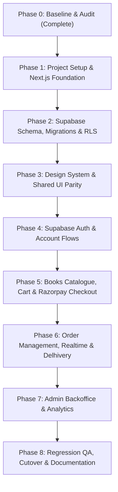

# Migration Plan: MD Shakib Islamic Books

## 1. Migration Strategy: Side-by-Side Coexistence

To ensure zero risk of breaking existing functionality, losing historical uncommitted work, or causing downtime, the migration will follow a **side-by-side coexistence pattern**:

1. The existing `/client` and `/server` directories will remain completely intact and untouched until all Next.js App Router flows pass regression testing.
2. The new Next.js full-stack application will be initialized in a dedicated root directory (`/app` or modern Next.js root layout), coexisting peacefully with legacy folders.
3. Database migrations will be version-controlled in `/supabase/migrations`.
4. No legacy code will be deleted or retired until Phase 8 (Final Cutover & Verification).

---

## 2. Phased Implementation Roadmap

---

### Phase 1: Project Setup & Next.js Foundation
- **Objectives:** Initialize Next.js 15+ App Router with React 19, TypeScript (strict), and Tailwind CSS v4 in the workspace without disturbing `/client` or `/server`.
- **Key Tasks:**
  1. Configure `package.json` with scripts: `dev`, `build`, `start`, `lint`, `typecheck`, `test`.
  2. Setup Tailwind CSS v4 with `@theme` block matching exact colors (`#C9A24A`, `#0B0B0B`, `#111111`, `#2A2A2A`) and Google Fonts (`Cinzel`, `Inter`).
  3. Configure `@supabase/ssr` middleware (`middleware.ts`) for server-side cookie sessions.
  4. Create environment templates: `.env.example` and `.env.local`.
- **Acceptance Criteria:** `npm run build` and `npm run typecheck` pass with zero errors.

---

### Phase 2: Supabase Schema, Migrations & RLS
- **Objectives:** Provision the relational PostgreSQL database schema with constraints, indexes, Row Level Security, and atomic stored procedures.
- **Key Tasks:**
  1. Author version-controlled SQL migration files in `supabase/migrations/`:
     - Tables: `profiles`, `books`, `addresses`, `carts`, `cart_items`, `orders`, `order_items`, `order_status_history`, `payments`, `audit_logs`, `email_logs`, `registration_otps`.
     - Indexes: Full-text search vector on books, composite indexes on orders, unique constraints on cart items and payments.
  2. Define and verify RLS policies for public, customer, and admin roles.
  3. Deploy stored procedures: `create_order_atomic` and `cancel_order_atomic`.
  4. Create seed script (`supabase/seed.sql`) populating initial categories and sample books.
- **Acceptance Criteria:** Migration runs cleanly; atomic transactions prevent negative stock; RLS blocks cross-user data access.

---

### Phase 3: Design System & Shared UI Parity
- **Objectives:** Migrate all foundational presentation components from `client/src/components` to TypeScript Next.js components.
- **Key Tasks:**
  1. Layouts: `Navbar.tsx`, `Footer.tsx`, `MobileBottomNav.tsx`, `AdminLayout.tsx`.
  2. Storefront UI: `HeroSection.tsx`, `CategoryTabs.tsx`, `ProductGrid.tsx`, `BookCard.tsx`, `OrderSteps.tsx`, `Reviews.tsx`, `TrustIndicators.tsx`.
  3. Modals & Feedback: `ToastContext.tsx`, `Loader.tsx`, `EmptyState.tsx`, `AdminConfirmModal.tsx`, `LogoutModal.tsx`.
  4. Fix Vite `ErrorBoundary.jsx` bug by implementing Next.js `app/error.tsx` and `app/global-error.tsx`.
  5. Add missing footer legal pages: `/terms`, `/privacy-policy`, and `/contact`.
- **Acceptance Criteria:** Side-by-side browser rendering check shows zero visual deviation from legacy client at desktop, tablet, and mobile viewports.

---

### Phase 4: Supabase Auth & Account Flows
- **Objectives:** Replace custom JWT logic with Supabase Auth (`@supabase/ssr`) and Resend email OTPs.
- **Key Tasks:**
  1. Email Registration OTP flow: `verify-email` → `verify-registration-otp` → `register`.
  2. Password Recovery OTP flow: `forgot-password` → `verify-otp` → `reset-password`.
  3. Authentication: `login`, `logout` modal, persistent server sessions, route protection in `middleware.ts`.
  4. Customer Profile: view and edit profile details, change password with old password validation.
  5. Customer Addresses: list, add, edit, delete, and set default shipping address.
- **Acceptance Criteria:** Successful registration requires valid Resend OTP; rate limits prevent spam; auth redirects preserve `state.from`.

---

### Phase 5: Books Catalogue, Cart & Razorpay Checkout
- **Objectives:** Implement catalogue browsing, search, guest-to-account cart merging, and Razorpay payments.
- **Key Tasks:**
  1. Book listing page (`/books`) with server-side filtering, sorting, price range, and search.
  2. Dynamic product detail page (`/books/[id]`) with multi-image Cloudinary gallery and related books.
  3. Hybrid cart system: persistent in localStorage for guests, synchronized with Supabase for authenticated users, with auto-merge on login.
  4. Checkout page (`/checkout`) integrating `AddressSelector`, authoritative price breakdown (synchronizing ₹10 platform fee and ₹35 delivery fee), and Razorpay SDK checkout modal.
  5. Razorpay Route Handlers: `create-intent`, `verify` (HMAC-SHA256 signature check), and `webhook` (raw body verification).
- **Acceptance Criteria:** Stock reduces atomically upon order placement; Razorpay signature verification passes; payment capture marks order as `Paid`.

---

### Phase 6: Order Management, Realtime & Delhivery
- **Objectives:** Implement customer order tracking, cancellation, replacement requests, Delhivery shipping, and Supabase Realtime updates.
- **Key Tasks:**
  1. Customer order history (`/orders`) and detailed visual tracking timeline (`/orders/[id]`).
  2. Order cancellation (atomically restoring inventory) and 7-day replacement request submission.
  3. Supabase Realtime channels for live status pushes (`orderStatusUpdated`, `paymentUpdated`).
  4. Delhivery integration: pincode serviceability check, AWB generation upon admin shipment creation, and tracking webhook handler.
  5. Resend order confirmation emails dispatched with full itemized invoice table.
- **Acceptance Criteria:** Status changes update in browser without refresh; cancellation restores stock; Delhivery AWB is saved.

---

### Phase 7: Admin Backoffice & Analytics
- **Objectives:** Implement complete administrative management and real-time dashboard analytics.
- **Key Tasks:**
  1. Admin dashboard (`/admin/dashboard`) with real-time PostgreSQL metric counters and revenue charts.
  2. Book management (`/admin/books`, `/admin/books/add`) with multi-image Cloudinary upload, stock adjustments, and cover selector.
  3. Order lifecycle management (`/admin/orders`) enforcing `ORDER_STATUS_TRANSITIONS` state machine.
  4. Replacement processing: admin approval or rejection with mandatory rejection note.
  5. User directory (`/admin/users`) with account blocking/unblocking and soft-deletion.
- **Acceptance Criteria:** Only authenticated users with `role = 'admin'` can access `/admin/*`; all actions record audit logs.

---

### Phase 8: Regression QA, Cutover & Documentation
- **Objectives:** Comprehensive automated and manual testing, performance audit, and production cutover readiness.
- **Key Tasks:**
  1. Execute unit, integration, and visual regression test suites.
  2. Verify all 35 features against `FEATURE_PARITY_MATRIX.md`.
  3. Validate Vercel production build (`next build`) and audit bundle sizes.
  4. Document production cutover checklist in `docs/migration/CUTOVER_AND_ROLLBACK.md`.
  5. Update root `README.md` with Next.js development instructions.
- **Acceptance Criteria:** 100% feature parity verified; zero critical security vulnerabilities; production build succeeds cleanly.

