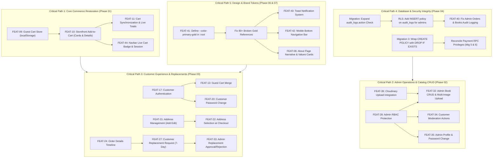

# Feature Dependency & Blocker Matrix
## MD Shakib Islamic Books — Inter-Feature & Inter-Phase Dependency Map

> **Phase:** Phase 00 — Baseline & Audit Freeze  
> **Scope:** Comprehensive mapping of architectural dependencies, prerequisite sequences, critical paths, and external blockers across all 44 features and 12 implementation phases.

---

## 1. Core Feature Dependency Map

| Upstream Feature (Prerequisite) | Downstream Feature (Dependent) | Nature & Reason for Dependency | Type | Impact if Upstream Fails | Can Work in Parallel? |
|---|---|---|:---:|---|:---:|
| **FEAT-41: Brand Design Tokens** | **All UI Components & Pages** (FEAT-01..08, 42..44) | Design token `--color-primary-gold` is referenced by 80+ components; without it, gold typography, borders, and buttons render broken or transparent. | **Confirmed** | Visual degradation and branding failure across 30+ pages. | No (Tokens should be fixed first in Phase 06). |
| **FEAT-09: Guest Shopping Cart** | **FEAT-10: Storefront Add to Cart** | Guest users browsing the storefront need a client-side cart store (`localStorage`) to hold items before authentication. | **Confirmed** | Unauthenticated visitors cannot add items to cart. | Yes (Can build client store and button handlers together). |
| **FEAT-10: Add to Cart Action** | **FEAT-11: Authenticated Cart Sync** | Cart synchronization requires operational add-to-cart mutations to create and populate cart items. | **Confirmed** | Shopping cart remains empty; checkout cannot be tested naturally. | No. |
| **FEAT-10: Add to Cart Action** | **FEAT-44: Navbar State Sync** | Navbar cart badge count depends on operational cart additions to calculate and display the live item badge. | **Confirmed** | Navbar cart badge remains static at 0. | Yes (Navbar can accept prop while cart store is being built). |
| **FEAT-09: Guest Shopping Cart** | **FEAT-13: Guest Cart Merge** | Cart merge requires existing items in `localStorage` to read and merge into the user's database cart upon login. | **Confirmed** | Guest items are lost when visitor authenticates. | No. |
| **FEAT-17: Customer Authentication** | **FEAT-13: Guest Cart Merge** | Guest cart can only merge when an authenticated user session is established. | **Confirmed** | Merge logic cannot identify target `user_id`. | No. |
| **FEAT-17: Customer Authentication** | **FEAT-19: Profile View/Edit** | Customer profile requires authenticated session to query `public.profiles` for `auth.uid()`. | **Confirmed** | Profile page redirects to `/login`. | No. |
| **FEAT-17: Customer Authentication** | **FEAT-21: Address Management** | Address creation and listing enforces RLS policy `user_id = auth.uid()`. | **Confirmed** | Address queries fail RLS authorization. | No. |
| **FEAT-21: Address Management** | **FEAT-22: Address Selection** | Checkout requires saved delivery addresses in `public.addresses` to populate the selection radio list. | **Confirmed** | Customer cannot select delivery address or proceed to payment. | No. |
| **FEAT-22: Address Selection** | **FEAT-14: COD Checkout** | Order creation requires a valid delivery address snapshot to write into `orders.shipping_address`. | **Confirmed** | Order creation is blocked by missing address validation. | No. |
| **FEAT-14: Order Creation (COD)** | **FEAT-23: Order History** | Order history queries customer's placed orders; without orders, history is permanently empty. | **Confirmed** | Orders page displays empty state only. | No. |
| **FEAT-14: Order Creation (COD)** | **FEAT-24: Order Details & Timeline** | Order details page requires an existing order UUID to fetch items, address, and status history. | **Confirmed** | Customer order details page cannot be viewed. | No. |
| **FEAT-24: Order Details** | **FEAT-26: Order Cancellation** | Customer order cancellation is initiated from the order details screen. | **Confirmed** | Customer cannot trigger cancellation flow. | No. |
| **FEAT-24: Order Details** | **FEAT-27: Replacement Request** | Customer replacement request requires delivered order details to verify 7-day eligibility. | **Confirmed** | Customer cannot request replacement. | No. |
| **FEAT-27: Replacement Request** | **FEAT-33: Admin Replacement Review** | Admin can only approve or reject replacement requests that have been submitted by customers. | **Confirmed** | Admin replacement queue remains empty. | No. |
| **FEAT-28: Admin RBAC & Route Guard** | **FEAT-29: Admin Dashboard** | Admin dashboard queries sensitive store revenue and order metrics protected by `is_admin()`. | **Confirmed** | Dashboard fails RLS or leaks data to non-admins. | No. |
| **FEAT-28: Admin RBAC & Route Guard** | **FEAT-30: Admin Orders** | Admin order management requires administrator privileges to view all customers' orders. | **Confirmed** | Order table fails RLS query. | No. |
| **FEAT-28: Admin RBAC & Route Guard** | **FEAT-32: Admin Book CRUD** | Book creation, editing, and stock adjustment require admin credentials and RLS `books_admin_all`. | **Confirmed** | Catalog mutations rejected by PostgreSQL. | No. |
| **FEAT-28: Admin RBAC & Route Guard** | **FEAT-34: Customer Moderation** | Blocking and soft-deleting accounts requires admin permissions and profile mutation privileges. | **Confirmed** | Moderation mutations fail. | No. |
| **FEAT-39: Cloudinary Media Upload** | **FEAT-32: Admin Book CRUD** | Book creation and editing in admin panel requires uploading cover images to Cloudinary to save URLs. | **Confirmed** | Books created without imagery or require external manual image hosting. | Yes (Can build text CRUD with dummy URLs while wiring upload). |
| **FEAT-40: Audit Logging Fix** | **FEAT-31: Admin Order Transitions** | Admin order transitions attempt to insert audit logs; constraint failure breaks transition action. | **Confirmed** | Order status updates fail or fail to record security audit ledger. | No. |
| **FEAT-40: Audit Logging Fix** | **FEAT-32: Admin Book CRUD** | Book creation and editing actions record audit logs in `audit_logs`. | **Confirmed** | Book actions fail if audit constraint rejects action strings. | No. |
| **FEAT-36: Razorpay Integration** | **FEAT-15: Razorpay Checkout** | Online payment requires Razorpay order creation API, key ID, and secret to verify signatures. | **Confirmed** | Razorpay modal fails to open or signature verification fails. | No. |
| **FEAT-37: Delhivery Integration** | **FEAT-31: Shipment Booking** | Admin consignment creation requires Delhivery API client and authorization token. | **Confirmed** | Shipment creation fails; no AWB generated. | No. |
| **FEAT-38: Resend Integration** | **FEAT-14, 15, 26, 31: Email Triggers** | Outbound transactional emails (order confirmation, cancellation, shipment) depend on Resend client. | **Confirmed** | Emails fail to deliver; error logged in `email_logs`. | Yes (Email service is asynchronous and fail-open). |

---

## 2. Critical Implementation Paths

---

## 3. External Dependencies & Operational Blockers

| External Dependency | Consuming Modules / Features | Required Secret / Environment Variable | Current Status in Workspace | Fallback / Mock Strategy |
|---|---|---|:---:|---|
| **Supabase PostgreSQL Direct Credentials** | Phase 04 / Phase 11 Database Migrations | `DATABASE_URL` (direct wire connection on port 5432 or 6543) | **BLOCKED (Password not in repo)** | Operator must execute SQL preflight and migrations in Supabase Dashboard SQL Editor or provide authenticated connection string. |
| **Razorpay API Keys** | FEAT-15 (Checkout), FEAT-36 (Payments) | `RAZORPAY_KEY_ID`, `RAZORPAY_KEY_SECRET`, `RAZORPAY_WEBHOOK_SECRET` | Available in `.env.local` (Test Mode) | Razorpay test sandbox allows full end-to-end payment simulations without live monetary debits. |
| **Delhivery Logistics API** | FEAT-31 (Shipment), FEAT-37 (Logistics) | `DELHIVERY_API_TOKEN`, `DELHIVERY_CLIENT_ID`, `DELHIVERY_WEBHOOK_SECRET` | Available in `.env.local` | Sandbox staging API endpoint validates 6-digit pincodes and simulates tracking webhooks. |
| **Resend API Key** | FEAT-38 (Emails) | `RESEND_API_KEY`, `RESEND_FROM_EMAIL` | Available in `.env.local` | Asynchronous fail-open logging in `email_logs`; test delivery using verified sender domain. |
| **Cloudinary Credentials** | FEAT-32 (Catalog), FEAT-39 (Media) | `CLOUDINARY_CLOUD_NAME`, `CLOUDINARY_API_KEY`, `CLOUDINARY_API_SECRET` | Available in `.env.local` | Direct signed uploads or server proxy uploads with binary magic-byte detection. |

---

## 4. Cross-Phase Dependency Sequence

| Implementation Phase | Prerequisites Required | Key Unblocked Outputs |
|:---:|---|---|
| **Phase 00: Baseline & Audit Freeze** | None (Read-only repository audit) | Authoritative baseline, checklist, matrix, preflight review. |
| **Phase 01: Critical Functional Restoration** | Phase 00 Approval | Operational Add to Cart, Guest Cart, Navbar cart badge sync. Unblocks natural e-commerce customer journey. |
| **Phase 02: Complete Admin Management** | Phase 00 Approval, Phase 04 DB alignment | Admin Book CRUD, Cloudinary upload, Customer moderation, Admin profile. Unblocks catalog management. |
| **Phase 03: Customer Account & Commerce** | Phase 01 (Cart), Phase 00 Approval | Address editing, Password change, 7-day replacement flow, Cart merge. Unblocks full post-order customer self-service. |
| **Phase 04: Backend & Database Integrity** | Phase 00 Preflight Review | Audit log constraint migration, RLS policy fix, Migration 3 idempotency, Payment RPC verification. |
| **Phase 05: Frontend & Content Parity** | Phase 01 (Storefront) | About page 100% restoration, Homepage OrderSteps & Reviews, Support FAQ 8-category parity. |
| **Phase 06: Design System & UI/UX** | Phase 00 Audit | `--color-primary-gold` defined in `:root`, luxury typography weights (Cinzel 800/900), container harmonization. |
| **Phase 07: Animation & Micro-interactions** | Phase 06 (Design Tokens) | Toast notification system, modal transitions, card hover physics, smooth micro-interactions. |
| **Phase 08: Advanced UX & Accessibility** | Phase 06 (Design Tokens) | MobileBottomNav component, WCAG 2.1 AA a11y compliance, keyboard navigation, tap target spacing. |
| **Phase 09: Integration & End-to-End QA** | Phases 01–04 | Automated Newman/Postman integration suite, Razorpay test harness, Delhivery consignment verification. |
| **Phase 10: Performance & Security** | Phases 01–09 | Lighthouse 90+ audit, ISR revalidation tuning, Content Security Policy headers, rate limiting. |
| **Phase 11: Final Production Release** | Phases 01–10, User Authorization | Authorized database migration execution, production smoke tests, cutover validation. |

