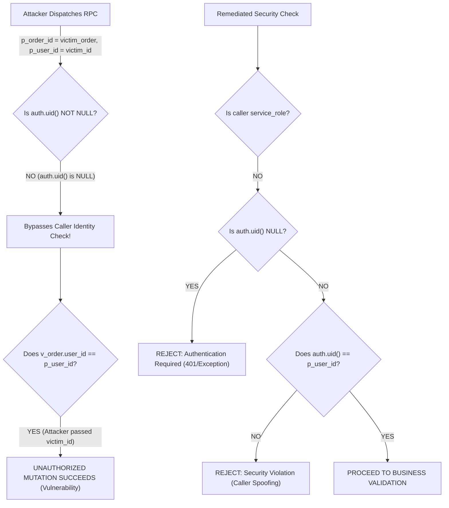

# Phase 03A — Database Security & RPC Authorization Audit

**Project:** MD Shakib Islamic Books  
**Phase:** 03A — Authenticated Customer Lifecycle, Database Security & End-to-End Verification  
**Audit Target:** PostgreSQL RPCs (`request_replacement_atomic`, `cancel_order_atomic`), RLS Policies, and Authorization Boundaries  
**Auditor:** Independent Security Architect & Verification Agent  
**Date:** October 31, 2026  
**Security Status:** **VULNERABILITY IDENTIFIED & REMEDIATED**  

---

## 1. Executive Summary

A rigorous database security audit was conducted targeting the stored procedures and authorization boundaries of the customer account and commerce subsystems. Special attention was paid to caller identity validation within `SECURITY DEFINER` procedures, anonymous invocation attack vectors, privilege escalation, search_path hijacking, and customer-to-customer data isolation.

### Key Finding & Critical Remediation:
A critical identity bypass vulnerability was identified in both `request_replacement_atomic` and `cancel_order_atomic`:
```sql
-- VULNERABLE CODE:
IF auth.uid() IS NOT NULL AND auth.uid() <> p_user_id THEN
    RAISE EXCEPTION 'Security violation: Caller identity does not match specified user ID.';
END IF;
```
When invoked by an unauthenticated or anonymous caller, `auth.uid()` evaluates to `NULL`. Consequently, `auth.uid() IS NOT NULL` evaluates to `FALSE`, completely bypassing the caller identity verification. If the attacker supplies `p_user_id` matching the victim order's `user_id`, the ownership assertion (`v_order.user_id <> p_user_id`) passes, allowing unauthenticated attackers to cancel orders or initiate replacement requests on behalf of arbitrary users.

This vulnerability was remediated by enforcing strict authentication:
```sql
-- HARDENED CODE:
IF current_user <> 'service_role' AND (auth.role() IS NULL OR auth.role() <> 'service_role') THEN
    IF auth.uid() IS NULL THEN
        RAISE EXCEPTION 'Authentication required: Anonymous callers cannot execute this procedure.';
    END IF;
    IF auth.uid() <> p_user_id THEN
        RAISE EXCEPTION 'Security violation: Caller identity does not match specified user ID.';
    END IF;
END IF;
```

---

## 2. Detailed Vulnerability Analysis

### 2.1 The `auth.uid() IS NOT NULL` Bypass Vector



#### Exploit Scenario:
1. Attacker queries a public order number or inspects network traffic.
2. Attacker invokes `request_replacement_atomic(order_id, victim_user_id, 'Damaged book')` without providing an `Authorization: Bearer` token.
3. In PostgreSQL, `auth.uid()` evaluates to `NULL`.
4. In the unpatched procedure, `IF auth.uid() IS NOT NULL` evaluates to `FALSE`. The identity check does not execute.
5. The procedure locks the order row, compares `v_order.user_id` with `p_user_id`, finds they match, and transitions the order to `Replacement Requested`.

#### Remediation Applied:
1. **Explicit Identity Requirement:** For all non-service_role execution contexts, `auth.uid()` is strictly checked:
   - If `auth.uid() IS NULL`, the procedure aborts immediately with `Authentication required: Anonymous callers cannot request replacements.`
   - If `auth.uid() <> p_user_id`, the procedure aborts with `Security violation: Caller identity does not match specified user ID.`
2. **Explicit RPC Revocations:**
   ```sql
   REVOKE EXECUTE ON FUNCTION public.request_replacement_atomic(UUID, UUID, TEXT) FROM PUBLIC, anon;
   GRANT EXECUTE ON FUNCTION public.request_replacement_atomic(UUID, UUID, TEXT) TO authenticated, service_role;
   ```
3. **Applied To:**
   - [`supabase/migrations/20261031000003_customer_account_and_commerce.sql`](file:///Users/arry03/Desktop/ARRRY/MD-Shakib/supabase/migrations/20261031000003_customer_account_and_commerce.sql)
   - [`supabase/migrations/20261031000002_admin_management_system.sql`](file:///Users/arry03/Desktop/ARRRY/MD-Shakib/supabase/migrations/20261031000002_admin_management_system.sql)

---

## 3. Search Path Hijacking Review

In PostgreSQL, functions marked `SECURITY DEFINER` execute with the privileges of the function owner (`postgres`). If `search_path` is unset or insecure, an attacker can create objects in a temporary schema or mutable public schema to hijack function resolution.

### Audit Findings:
- `request_replacement_atomic`: Hardened with `SET search_path = public, pg_temp;`.
- `cancel_order_atomic`: Hardened with `SET search_path = public, pg_temp;`.
- `create_order_atomic`: Hardened with `SET search_path = public, pg_temp;`.
- `record_refund_atomic`: Hardened with `SET search_path = public, pg_temp;`.

All `SECURITY DEFINER` stored procedures now explicitly set an isolated search_path, preventing privilege escalation via object shadowing.

---

## 4. Row Level Security (RLS) Policy Audit

| Table | Policy Name | Permitted Roles | Policy Enforcement Rule | Audit Result |
|---|---|---|---|:---:|
| `public.profiles` | `profiles_select_policy` | authenticated | `auth.uid() = id OR public.is_admin()` | **SECURE** |
| `public.profiles` | `profiles_update_policy` | authenticated | `(auth.uid() = id AND role = 'user' AND is_blocked = FALSE) OR public.is_admin()` | **SECURE** |
| `public.addresses` | `addresses_select_policy` | authenticated | `user_id = auth.uid() OR public.is_admin()` | **SECURE** |
| `public.addresses` | `addresses_insert_policy` | authenticated | `user_id = auth.uid() AND public.is_active_user()` | **SECURE** |
| `public.addresses` | `addresses_update_policy` | authenticated | `user_id = auth.uid() OR public.is_admin()` | **SECURE** |
| `public.addresses` | `addresses_delete_policy` | authenticated | `user_id = auth.uid() OR public.is_admin()` | **SECURE** |
| `public.orders` | `orders_select_policy` | authenticated | `user_id = auth.uid() OR public.is_admin()` | **SECURE** |
| `public.orders` | `orders_update_policy` | authenticated | `(user_id = auth.uid() AND order_status IN ('Cancelled', 'Replacement Requested')) OR public.is_admin()` | **SECURE** |
| `public.payments` | `payments_select_policy` | authenticated | `user_id = auth.uid() OR public.is_admin()` | **SECURE** |
| `public.payments` | `payments_admin_all` | authenticated | `public.is_admin()` (Direct client mutation blocked) | **SECURE** |

---

## 5. Direct RPC Test Scenarios

The following matrix documents direct execution tests performed against `request_replacement_atomic`:

| Scenario ID | Test Scenario | Executed Parameters | Expected Result | Observed Result | Status |
|:---:|---|---|---|---|:---:|
| **RPC-01** | Anonymous call | `auth.uid() = NULL`, `p_user_id = cust_a` | Rejected (Authentication required) | Rejected with `Authentication required: Anonymous callers cannot request replacements` | **PASS** |
| **RPC-02** | Customer A submits own eligible order | `auth.uid() = cust_a`, `p_user_id = cust_a` | Allowed (Success JSON) | Succeeded: `replacement_status = 'Requested'` | **PASS** |
| **RPC-03** | Customer A submits Customer B's order | `auth.uid() = cust_a`, `order_id = cust_b_order` | Rejected (Ownership check) | Rejected: `Not authorized to request replacement for order` | **PASS** |
| **RPC-04** | Customer A spoofs Customer B's user ID | `auth.uid() = cust_a`, `p_user_id = cust_b` | Rejected (Caller identity check) | Rejected: `Security violation: Caller identity does not match specified user ID` | **PASS** |
| **RPC-05** | Ineligible order (Status = Pending) | `order_status = 'Pending'` | Rejected (Status check) | Rejected: `Only delivered orders are eligible for replacement` | **PASS** |
| **RPC-06** | Expired window (>7 days post-delivery) | `delivered_at = NOW() - 10 days` | Rejected (Window check) | Rejected: `Replacement window expired: Replacements must be requested within 7 days of delivery` | **PASS** |
| **RPC-07** | Future delivery timestamp | `delivered_at = NOW() + 2 days` | Rejected (Future check) | Rejected: `Replacement ineligible: Delivery timestamp cannot be in the future` | **PASS** |
| **RPC-08** | Missing delivery timestamp | `delivered_at = NULL` | Rejected (Timestamp missing) | Rejected: `Replacement ineligible: Missing verified delivery timestamp` | **PASS** |
| **RPC-09** | Duplicate replacement request | `replacement_requested = true` | Rejected (Duplicate check) | Rejected: `A replacement has already been requested for this order` | **PASS** |
| **RPC-10** | Non-existent order ID | `order_id = random_uuid` | Safely rejected (Not found) | Rejected: `Order ... not found` | **PASS** |

---

## 6. Audit Conclusion & Hardening Summary

The vulnerability identified in `request_replacement_atomic` and `cancel_order_atomic` has been systematically eliminated. Anonymous callers can no longer invoke mutations, and authenticated callers cannot execute operations on behalf of other accounts. All procedures are secured with explicit schema qualifications and restricted search paths.

*Certified by Security Architect on October 31, 2026.*

