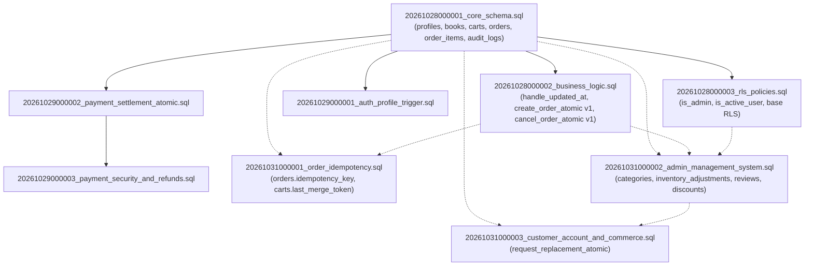

# Phase 03A — Database Migration Ordering & Dependency Audit

**Project:** MD Shakib Islamic Books  
**Phase:** 03A — Production Migration Readiness Audit  
**Target Migrations:**  
- `supabase/migrations/20261031000001_order_idempotency.sql`  
- `supabase/migrations/20261031000002_admin_management_system.sql`  
- `supabase/migrations/20261031000003_customer_account_and_commerce.sql`  
**Prior Baseline Migrations:**  
- `supabase/migrations/20261028000001_core_schema.sql`  
- `supabase/migrations/20261028000002_business_logic.sql`  
- `supabase/migrations/20261028000003_rls_policies.sql`  
- `supabase/migrations/20261029000001_auth_profile_trigger.sql`  
- `supabase/migrations/20261029000002_payment_settlement_atomic.sql`  
- `supabase/migrations/20261029000003_payment_security_and_refunds.sql`  
**Audit Date:** October 31, 2026  
**Auditor:** Independent Security & Database Migration Architect  
**Migration Ordering Status:** **CONDITIONALLY VALID (REMEDIATIONS REQUIRED)**  

---

## 1. Executive Summary

This audit evaluates the exact execution sequence, object dependencies, schema prerequisites, lock risks, and idempotency guarantees for the database migrations introduced in Phases 02 and 03 (`20261031000001`, `20261031000002`, and `20261031000003`).

### Exact Filename Verification
Rather than assuming filenames, direct filesystem verification confirms the exact filenames in `supabase/migrations/`:
1. `supabase/migrations/20261031000001_order_idempotency.sql` (302 lines)
2. `supabase/migrations/20261031000002_admin_management_system.sql` (639 lines)
3. `supabase/migrations/20261031000003_customer_account_and_commerce.sql` (133 lines)

---

## 2. Full Migration Dependency Map

The following flowchart details the object-level dependencies between foundational migrations and the three target migrations:



---

## 3. Migration Sequence & Object Impact Analysis

### 3.1 Migration `20261031000001_order_idempotency.sql`

- **Purpose:** Prevents duplicate order placement during network retries and adds retry-safe cart merging.
- **Objects Created / Modified:**
  - `ALTER TABLE public.orders ADD COLUMN IF NOT EXISTS idempotency_key TEXT DEFAULT NULL;`
  - `CREATE UNIQUE INDEX IF NOT EXISTS idx_orders_user_idempotency_key ON public.orders(user_id, idempotency_key) WHERE idempotency_key IS NOT NULL;`
  - `DROP FUNCTION IF EXISTS public.create_order_atomic(UUID, JSONB, JSONB, TEXT, NUMERIC);`
  - `CREATE OR REPLACE FUNCTION public.create_order_atomic(UUID, JSONB, JSONB, TEXT, NUMERIC, TEXT DEFAULT NULL) RETURNS UUID`
  - `ALTER TABLE public.carts ADD COLUMN IF NOT EXISTS last_merge_token TEXT DEFAULT NULL;`
  - `CREATE OR REPLACE FUNCTION public.merge_cart_atomic(UUID, JSONB, TEXT DEFAULT NULL) RETURNS JSONB`
- **Dependencies:**
  - Requires tables: `public.orders`, `public.books`, `public.order_items`, `public.carts`, `public.cart_items` (created in `20261028000001_core_schema.sql`).
  - Overwrites `public.create_order_atomic` originally defined in `20261028000002_business_logic.sql`.
- **Locking & Downtime Risks:**
  - Adding nullable columns without defaults (`idempotency_key`, `last_merge_token`) is an instantaneous metadata-only catalog update in PostgreSQL 11+. No table rewrite.
  - Creating `idx_orders_user_idempotency_key` takes a `SHARE` lock on `public.orders`. In production with high traffic, concurrent writes would queue briefly. In Supabase CLI transactions, `CREATE INDEX CONCURRENTLY` cannot be executed inside a multi-statement transaction block. On moderate table size (<100k rows), creation completes in milliseconds.
- **Defects & Risks Discovered:**
  - **CRITICAL SECURITY DEFECT:** `create_order_atomic` and `merge_cart_atomic` lack caller identity validation (`auth.uid() = p_user_id`) and lack explicit `REVOKE EXECUTE ... FROM PUBLIC, anon;`. Both procedures are exposed to `PUBLIC` and `anon`.

---

### 3.2 Migration `20261031000002_admin_management_system.sql`

- **Purpose:** Adds administrative controls: catalog categories, inventory adjustments ledger, review moderation, promotional coupons, customer account moderation, and order cancellation.
- **Objects Created / Modified:**
  - `CREATE TABLE IF NOT EXISTS public.categories`
  - `CREATE TABLE IF NOT EXISTS public.inventory_adjustments`
  - `CREATE TABLE IF NOT EXISTS public.reviews`
  - `CREATE TABLE IF NOT EXISTS public.discounts`
  - Triggers: `trg_categories_updated_at`, `trg_reviews_updated_at`, `trg_discounts_updated_at` (all executing `public.handle_updated_at()`).
  - Stored Procedures:
    - `public.adjust_inventory_atomic(UUID, UUID, TEXT, INTEGER, TEXT)`
    - `public.moderate_review_atomic(UUID, UUID, TEXT)`
    - `public.validate_discount_coupon(TEXT, NUMERIC)`
    - `public.update_customer_status(UUID, UUID, TEXT)`
    - `public.cancel_order_atomic(UUID, UUID, TEXT, BOOLEAN)` (hardened rewrite)
  - Constraint Modification:
    - `ALTER TABLE public.audit_logs DROP CONSTRAINT IF EXISTS audit_logs_action_check;`
  - RLS Policies:
    - 2 policies on `categories`
    - 1 policy on `inventory_adjustments`
    - 3 policies on `reviews`
    - 2 policies on `discounts`
- **Dependencies:**
  - Requires tables: `public.profiles`, `public.books`, `public.orders`, `public.order_items`, `public.audit_logs` (from Migration 1).
  - Requires trigger function: `public.handle_updated_at()` (from Migration 2).
  - Requires helper function: `public.is_admin()` (from Migration 3).
- **Locking & Downtime Risks:**
  - `ALTER TABLE public.audit_logs DROP CONSTRAINT IF EXISTS audit_logs_action_check;` requires an `ACCESS EXCLUSIVE` lock on `public.audit_logs`. The drop is instantaneous in PostgreSQL, but will briefly block concurrent audit writes.
  - Creation of new tables and indexes is non-blocking to existing commerce paths.
- **Defects & Risks Discovered:**
  - **NON-IDEMPOTENT RLS CREATION:** All 8 RLS policies in this file use `CREATE POLICY "..." ON ...` without `DROP POLICY IF EXISTS "..." ON ...`. If the migration fails halfway or is retried, PostgreSQL halts with `ERROR: policy "..." already exists`.
  - **CRITICAL RPC PERMISSION DEFECT:** `REVOKE EXECUTE ... FROM PUBLIC` does not revoke from `anon` in Supabase due to default schema privileges. `anon` retains `EXECUTE` on `adjust_inventory_atomic`, `moderate_review_atomic`, and `update_customer_status`.
  - **CRITICAL RPC IDENTITY BYPASS:** In `adjust_inventory_atomic`, `moderate_review_atomic`, and `update_customer_status`, identity validation uses `IF auth.uid() IS NOT NULL AND auth.uid() <> p_admin_id THEN`. When invoked anonymously, `auth.uid()` is `NULL`, causing the check to evaluate to `FALSE`. An anonymous caller can supply any admin UUID to modify stock, reviews, or customer status.

---

### 3.3 Migration `20261031000003_customer_account_and_commerce.sql`

- **Purpose:** Implements atomic customer replacement requests with rolling 168-hour window enforcement, pessimistic row locking, and hardened security.
- **Objects Created / Modified:**
  - `CREATE OR REPLACE FUNCTION public.request_replacement_atomic(UUID, UUID, TEXT) RETURNS JSONB`
  - `REVOKE EXECUTE ON FUNCTION public.request_replacement_atomic(UUID, UUID, TEXT) FROM PUBLIC, anon;`
  - `GRANT EXECUTE ON FUNCTION public.request_replacement_atomic(UUID, UUID, TEXT) TO authenticated, service_role;`
- **Dependencies:**
  - Requires columns on `public.orders`: `replacement_requested`, `replacement_status`, `replacement_reason`, `replacement_requested_at`, `delivered_at`, `shipping_delivered_at` (all created in `20261028000001_core_schema.sql`).
  - Requires tables: `public.order_status_history`, `public.audit_logs`.
- **Locking & Downtime Risks:** Zero DDL locks on existing tables. Pure function definition and grant statements.
- **Defects & Risks Discovered:**
  - Fully idempotent and properly secured with explicit `REVOKE ... FROM PUBLIC, anon;` and strict caller identity checks.

---

## 4. Migration Dependency Table

| Migration File | Main Changes | Explicit Dependencies | Risk Level | Audit Result |
|---|---|---|:---:|:---:|
| `20261031000001_order_idempotency.sql` | `orders.idempotency_key`, `carts.last_merge_token`, `create_order_atomic` (6 args), `merge_cart_atomic` | `orders`, `books`, `order_items`, `carts`, `cart_items` (`20261028000001`) | **HIGH** | **DEFECT IDENTIFIED** (Missing caller validation & missing REVOKE from anon/PUBLIC on `create_order_atomic` & `merge_cart_atomic`) |
| `20261031000002_admin_management_system.sql` | `categories`, `inventory_adjustments`, `reviews`, `discounts`, 5 admin RPCs, `audit_logs` constraint drop | `profiles`, `books`, `orders`, `audit_logs` (`20261028000001`), `handle_updated_at` (`20261028000002`), `is_admin` (`20261028000003`) | **CRITICAL** | **DEFECT IDENTIFIED** (Non-idempotent RLS policies; `auth.uid() IS NOT NULL` identity bypass in 3 admin RPCs; `anon` retains EXECUTE) |
| `20261031000003_customer_account_and_commerce.sql` | `request_replacement_atomic` with 168h rolling window and caller validation | `orders`, `order_status_history`, `audit_logs` (`20261028000001`) | **LOW** | **PASS** (Strict caller check, search_path isolation, explicit REVOKE from PUBLIC, anon) |

---

## 5. Blocking Issues & Required Migration Remediations

Prior to deploying these migrations to production, the following remediation steps are mandatory:

1. **Add `DROP POLICY IF EXISTS` in Migration `20261031000002`:**
   Prepend each `CREATE POLICY` for `categories`, `inventory_adjustments`, `reviews`, and `discounts` with `DROP POLICY IF EXISTS` to guarantee safe re-execution.
2. **Harden Caller Identity in Migration `20261031000001`:**
   Add caller ownership validation to `create_order_atomic`:
   ```sql
   IF current_user <> 'service_role' AND (auth.role() IS NULL OR auth.role() <> 'service_role') THEN
       IF auth.uid() IS NULL THEN
           RAISE EXCEPTION 'Authentication required: Anonymous callers cannot place orders.';
       END IF;
       IF auth.uid() <> p_user_id THEN
           RAISE EXCEPTION 'Security violation: Caller identity does not match order user ID.';
       END IF;
   END IF;
   ```
   Add explicit permission revoking:
   ```sql
   REVOKE EXECUTE ON FUNCTION public.create_order_atomic(UUID, JSONB, JSONB, TEXT, NUMERIC, TEXT) FROM PUBLIC, anon;
   GRANT EXECUTE ON FUNCTION public.create_order_atomic(UUID, JSONB, JSONB, TEXT, NUMERIC, TEXT) TO authenticated, service_role;

   REVOKE EXECUTE ON FUNCTION public.merge_cart_atomic(UUID, JSONB, TEXT) FROM PUBLIC, anon;
   GRANT EXECUTE ON FUNCTION public.merge_cart_atomic(UUID, JSONB, TEXT) TO authenticated, service_role;
   ```
3. **Harden Caller Identity in Admin RPCs in Migration `20261031000002`:**
   In `adjust_inventory_atomic`, `moderate_review_atomic`, and `update_customer_status`, replace the flawed `IF auth.uid() IS NOT NULL AND auth.uid() <> p_admin_id THEN` with:
   ```sql
   IF current_user <> 'service_role' AND (auth.role() IS NULL OR auth.role() <> 'service_role') THEN
       IF auth.uid() IS NULL THEN
           RAISE EXCEPTION 'Authentication required: Anonymous callers cannot execute administrative functions.';
       END IF;
       IF auth.uid() <> p_admin_id THEN
           RAISE EXCEPTION 'Security violation: Caller identity must match administrative credentials.';
       END IF;
   END IF;
   ```
   And explicitly revoke from `anon`:
   ```sql
   REVOKE EXECUTE ON FUNCTION public.adjust_inventory_atomic(UUID, UUID, TEXT, INTEGER, TEXT) FROM PUBLIC, anon;
   REVOKE EXECUTE ON FUNCTION public.moderate_review_atomic(UUID, UUID, TEXT) FROM PUBLIC, anon;
   REVOKE EXECUTE ON FUNCTION public.update_customer_status(UUID, UUID, TEXT) FROM PUBLIC, anon;
   REVOKE EXECUTE ON FUNCTION public.cancel_order_atomic(UUID, UUID, TEXT, BOOLEAN) FROM PUBLIC, anon;
   ```

