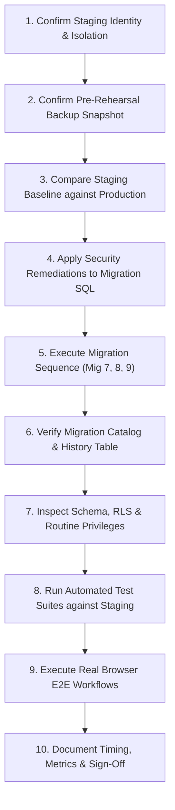

# Phase 03A — Staging Migration Rehearsal Plan

**Project:** MD Shakib Islamic Books  
**Phase:** 03A — Production Migration Readiness Audit  
**Purpose:** Rehearse Database Migrations and End-to-End Workflows on an Isolated Staging Environment  
**Audit Date:** October 31, 2026  
**Auditor:** Independent Database Architect & Security Auditor  
**Execution Status:** **PLANNING ONLY (NO STAGING MIGRATIONS EXECUTED DURING AUDIT)**  

---

## 1. Executive Summary & Rules of Engagement

Under **Safety Rule 12**, no staging migrations may be executed during this audit without explicit, separate authorization. This document outlines the exhaustive, step-by-step rehearsal procedure required before touching any production environment.

The staging environment must be an exact, isolated clone of the production architecture:
- Supabase project running identical PostgreSQL major version (PostgreSQL 17+).
- Same extensions installed (`uuid-ossp`, `pgcrypto`).
- Seeded with representative, non-sensitive catalog data and sanitized customer accounts.

---

## 2. Step-by-Step Staging Rehearsal Runbook



### Step 1: Confirm Staging Database Identity & Isolation
- Verify `NEXT_PUBLIC_SUPABASE_URL` and `SUPABASE_SERVICE_ROLE_KEY` in the staging environment point to the staging project, **never** to production project `mhyawpnjhajytetqppam`.
- Check database project name: `SELECT current_database(), inet_server_addr();`.

### Step 2: Confirm Staging Pre-Rehearsal Backup
- Take a pre-rehearsal snapshot of the staging database to test recovery mechanisms before applying any DDL.

### Step 3: Compare Staging Baseline against Production
- Execute the read-only catalog inspection script ([`PRODUCTION_SCHEMA_COMPATIBILITY.md`](file:///Users/arry03/Desktop/ARRRY/MD-Shakib/docs/migration/phase-03a/production-readiness/PRODUCTION_SCHEMA_COMPATIBILITY.md)) on staging to ensure staging matches production baseline.

### Step 4: Confirm Migration Sequence & Apply Security Remediations
- Verify the three target migrations in exact numerical sequence:
  1. `20261031000001_order_idempotency.sql` (with `create_order_atomic` identity check and REVOKE patch)
  2. `20261031000002_admin_management_system.sql` (with `DROP POLICY IF EXISTS` and admin RPC auth patches)
  3. `20261031000003_customer_account_and_commerce.sql`

### Step 5: Execute Migrations in Staging
- Execute migration sequence via Supabase CLI or psql:
  ```bash
  # Record start time
  REHEARSAL_START=$(date +%s)
  supabase db push --include-all
  REHEARSAL_END=$(date +%s)
  echo "Migration execution duration: $((REHEARSAL_END - REHEARSAL_START)) seconds"
  ```

### Step 6: Verify Migration History Table
- Confirm that all applied migrations are recorded:
  ```sql
  SELECT version, name FROM supabase_migrations.schema_migrations ORDER BY version DESC LIMIT 5;
  ```

### Step 7: Verify Schema, Indexes, RLS Policies & Routine Privileges
- Verify `orders.idempotency_key` and unique partial index.
- Verify 4 new tables: `categories`, `inventory_adjustments`, `reviews`, `discounts`.
- Verify all 15 public tables have RLS enabled: `SELECT count(*) FROM pg_tables WHERE schemaname = 'public' AND rowsecurity = true;` (Expected: 15).
- Verify routine execute privileges: Confirm `anon` does not hold EXECUTE on any mutating stored procedure (`adjust_inventory_atomic`, `update_customer_status`, `create_order_atomic`, `cancel_order_atomic`, `request_replacement_atomic`).

### Step 8: Run Automated Test Suites Against Staging
Execute the 8 test suites configured against the staging Supabase URL and service key:
1. `test-phase01-purchase-journey.ts` (20 tests)
2. `test-phase02-admin.ts` (36 tests)
3. `test-phase02a-verification.ts` (18 tests)
4. `test-phase02b-browser-e2e.ts` (26 tests)
5. `test-phase03-customer-account.ts` (20 tests)
6. `test-phase03a-eligibility-boundaries.ts` (10 tests)
7. `test-phase03a-security-and-lifecycle.ts` (13 tests)
8. `test-phase03a-browser-e2e.ts` (14 tests)
- **Target Result:** 157 / 157 passing (100%).

### Step 9: Rehearse Post-Migration Smoke Tests in Staging
- Perform manual and headless browser validations according to the [Post-Migration Smoke Test Plan](file:///Users/arry03/Desktop/ARRRY/MD-Shakib/docs/migration/phase-03a/production-readiness/POST_MIGRATION_SMOKE_TEST.md).
- Test customer checkout, order cancellation, and 7-day replacement submission.
- Test administrative order approval, stock adjustments, and coupon evaluation.

### Step 10: Record Metrics, Warnings & Sign-Off
- Record total DDL execution time, statement locks, PostgREST schema cache reloads, and any warning logs.
- Archive staging rehearsal report to `docs/migration/phase-03a/staging/STAGING_REHEARSAL_REPORT.md`.
- Obtain formal sign-off from Engineering Lead prior to scheduling production maintenance window.

