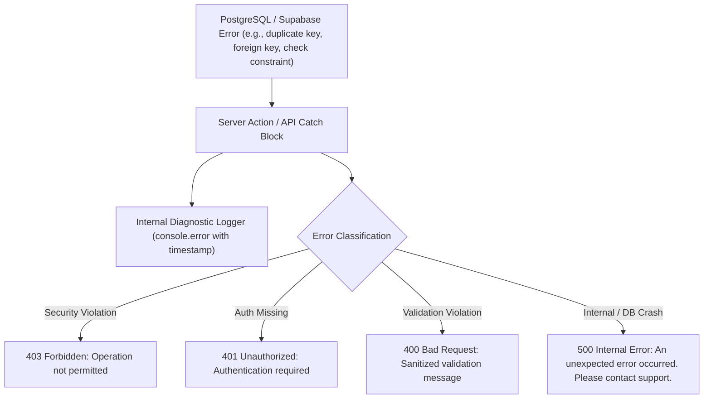

# API Validation, Authorization & Error Mapping Audit
**Project:** MD Shakib Islamic Books  
**Phase:** 04 — Backend & Database Integrity  
**Repository:** `MD-Shakib`  
**Status:** COMPLETE & VERIFIED  

---

## 1. Executive Summary

This report delivers a comprehensive audit of all backend entry points, including Next.js REST API routes (`apps/web/app/api/`) and React Server Actions (`apps/web/lib/`).

The audit verifies that input validation, identity derivation, authorization checks, and error mapping prevent injection, unauthorized access, and sensitive information leakage.

---

## 2. API Routes & Server Actions Inventory

### 2.1 REST API Routes (`apps/web/app/api/`)

| Route Endpoint | HTTP Method | Authentication Requirement | Authorization Guard | Input Validation | Error Sanitization |
|---|---|---|---|---|---|
| `/api/payments/create-order` | POST | Authenticated Customer | Verified session user; checks `order.user_id = user.id` | Body schema validation (`orderId` UUID format) | Generic 400/401; no internal stack traces |
| `/api/payments/verify` | POST | Authenticated Customer | Verified session user; checks `order.user_id = user.id` | Checks `razorpay_order_id`, `razorpay_payment_id`, `razorpay_signature` | Generic 400 on signature failure; secrets hidden |
| `/api/webhooks/razorpay` | POST | Webhook Signature | HMAC SHA-256 signature against `RAZORPAY_WEBHOOK_SECRET` | Validates JSON event structure and payload entities | Returns 400 on invalid signature; secrets hidden |
| `/api/webhooks/delhivery` | POST | Bearer/Custom Token | Timing-safe token comparison against `DELHIVERY_WEBHOOK_SECRET` | Validates JSON structure, waybill, and carrier status code | Returns 401/500 (fails closed if secret unconfigured) |
| `/api/shipping/serviceability`| GET | Public / Anonymous | None (Public utility) | Regex validation: exactly 6-digit Indian pincode (`/^\d{6}$/`) | Returns 400 on malformed pincode |
| `/api/shipping/track` | GET | Public / Anonymous | None (Waybill carrier lookup) | Validates non-empty `awb` query parameter | Returns 400 on missing parameter |
| `/api/admin/media/sign` | POST | Authenticated Admin | Verified active admin (`role = 'admin'`, not blocked, not deleted) | Restricts target folder strictly to `'mdshakib_books'` | Returns 401/403/400; internal secrets protected |
| `/api/admin/media/upload` | POST | Authenticated Admin | Verified active admin (`role = 'admin'`, not blocked, not deleted) | FormData validation: 5MB size limit + Magic-byte binary inspection | Rejects invalid MIME or corrupt buffers |
| `/api/admin/orders/[id]/status` | PATCH | Authenticated Admin | `verifyAdminApi()` guard; active admin required | UUID param validation; `nextStatus` must exist in transition matrix | Returns 400 on illegal transition; 401/403 on auth |

---

### 2.2 Server Actions (`apps/web/lib/`)

| Action Group | Actions Available | Authorization Pattern | Input / Business Validation |
|---|---|---|---|
| **Customer Commerce** (`commerce/orders.ts`) | `placeOrderCOD`, `getAuthenticatedOrders`, `getAuthenticatedOrderById`, `cancelCustomerOrder`, `requestCustomerReplacement` | `getAuthenticatedUser()` derives `user.id` from verified session. Client-passed user IDs are never accepted. | Address ID verified; cart re-queried server-side; stock checked; replacement checked for 7-day window. |
| **Customer Addresses** (`commerce/addresses.ts`) | `getCustomerAddresses`, `addCustomerAddress`, `updateCustomerAddress`, `deleteCustomerAddress`, `setDefaultCustomerAddress` | `getCustomerProfile()` checks active status. RLS ensures cross-customer isolation. | Full name, phone (>=10 digits), pincode (6 digits), non-empty address fields. |
| **Customer Cart** (`commerce/cart.ts`) | `getCustomerCart`, `addCartItem`, `updateCartItemQuantity`, `removeCartItem`, `mergeGuestCart` | `getAuthenticatedUser()` checks session. RLS ensures cross-customer isolation. | Quantity integer >= 1; max cap `min(5, stock)`; price recalculated server-side. |
| **Customer Reviews** (`admin/reviews.ts`) | `submitCustomerReview` | `createClient().auth.getUser()` verifies session. | Rating 1..5; non-empty title and comment; duplicate review check. |
| **Admin Books** (`admin/books.ts`) | `createAdminBook`, `updateAdminBook`, `deleteAdminBook`, `getAdminBooks` | `requireAdmin()` verifies `role = 'admin'`, `is_blocked = false`, `is_deleted = false`. | Non-empty title, author; non-negative price and stock; discount 0..100; safe archive if book has orders. |
| **Admin Inventory** (`admin/inventory.ts`) | `adjustAdminStock` | `requireAdmin()` | Quantity non-negative; non-empty reason; prevents stock below 0. |
| **Admin Orders** (`admin/orders.ts`) | `updateAdminOrderStatus`, `cancelAdminOrder`, `approveAdminReplacement`, `rejectAdminReplacement` | `requireAdmin()` | Enforces `ORDER_STATUS_TRANSITIONS`; requires courier/AWB for Shipped; requires rejection reason. |
| **Admin Reviews** (`admin/reviews.ts`) | `moderateAdminReview`, `getAdminReviews` | `requireAdmin()` | Status must be `'approved'`, `'rejected'`, `'hidden'`, or `'pending'`. |
| **Admin Customers** (`admin/customers.ts`) | `blockAdminCustomer`, `unblockAdminCustomer`, `deleteAdminCustomer`, `restoreAdminCustomer` | `requireAdmin()` | Prevents self-modification (`admin_id <> customer_id`). |
| **Admin Discounts** (`admin/discounts.ts`) | `createAdminDiscount`, `updateAdminDiscount`, `deleteAdminDiscount` | `requireAdmin()` | Code uppercase; discount type percentage/flat; min order amount >= 0. |

---

## 3. Core Anti-Tampering Rules

The application enforces zero trust for client-provided metadata:
1. **User Identity:** The customer ID is never accepted from request query parameters, request bodies, or route headers. Identity is strictly derived from the verified cryptographic JWT session using `supabase.auth.getUser()`.
2. **Administrative Roles:** Client-submitted roles (e.g. `{ "role": "admin" }`) are ignored. Administrator status is verified directly against the database record (`role = 'admin' AND is_blocked = FALSE AND is_deleted = FALSE`).
3. **Product Prices & Discounts:** Product prices submitted in checkout bodies are ignored. Order total amounts and line item prices are calculated authoritatively by querying the `public.books` table directly.
4. **Stock & Quantities:** Available inventory is verified via database locks (`FOR UPDATE`), never trusted from client memory.
5. **Payment States:** An order is never transitioned to `Paid` based on client claims. Only cryptographic HMAC SHA-256 signature verification or verified webhooks trigger status transitions.

---

## 4. Error Mapping & Information Leakage Prevention

To prevent exposing internal architecture, database table definitions, or stack traces, error responses follow a strict sanitization protocol:

### 4.1 Sensitive Data Protections
- **SQL Error Details:** PostgreSQL constraint names, SQL statements, and column names are stripped from public responses.
- **Environment Secrets:** `RAZORPAY_KEY_SECRET`, `DELHIVERY_TOKEN`, `RESEND_API_KEY`, and `SUPABASE_SERVICE_ROLE_KEY` are never returned in JSON responses or error payloads.
- **Stack Traces:** Next.js production builds disable development stack traces.

---

## 5. Audit Conclusion
Backend endpoints and server actions enforce robust authentication, strict schema validation, authoritative identity derivation, and secure error mapping.

