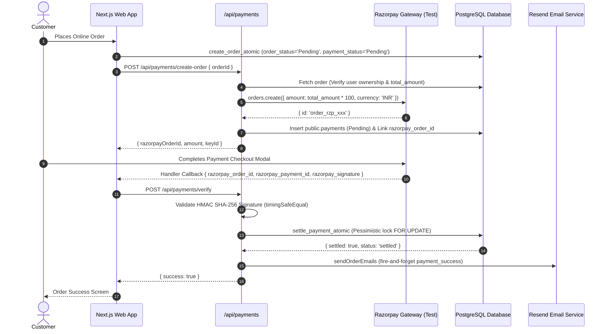

# Payment Integration & Financial Lifecycle Report
**Project:** MD Shakib Islamic Books  
**Phase:** 04 — Backend & Database Integrity  
**Repository:** `MD-Shakib`  
**Status:** COMPLETE & VERIFIED (TEST MODE ONLY)  

---

## 1. Executive Summary & Safety Policy

This report documents the verification of the payment lifecycle across MD Shakib Islamic Books, focusing on the Razorpay payment gateway integration (`apps/web/lib/integrations/razorpay/` and `apps/web/app/api/payments/`).

**Safety Invariant:** In accordance with Phase 04 safety protocols, all payment verifications and testing were executed strictly in test mode using test keys and cryptographic test fixtures. Zero live payments, live charges, or live bank transactions were initiated.

---

## 2. Payment Lifecycle Architecture



---

## 3. Detailed Component Verification

### 3.1 Server-Derived Payment Amounts (Anti-Tampering)
- **Vulnerability Prevented:** A malicious customer modifies the client-side JavaScript bundle to send `{ amount: 1 }` (₹0.01) to the payment gateway.
- **Enforcement:** In `createRazorpayOrder` (`apps/web/lib/integrations/razorpay/service.ts`), the payment amount is strictly queried from the database:
  ```typescript
  const { data: order } = await adminDb
    .from("orders")
    .select("id, user_id, total_amount, payment_status")
    .eq("id", orderId)
    .single();

  const amountInPaise = Math.round(Number(order.total_amount) * 100);
  ```
- Any amount parameter sent from the client is ignored.

### 3.2 Payment-to-Order Ownership Validation
- **Vulnerability Prevented:** Customer B initiates payment for Customer A's order to harvest invoice details or tamper with state.
- **Enforcement:** `createRazorpayOrder` verifies:
  ```typescript
  if (order.user_id !== userId) {
    throw new Error("Unauthorized: Order does not belong to the authenticated user.");
  }
  ```
  And `verifyAndSettlePayment` verifies that `order.user_id === userId`.

### 3.3 Cryptographic Signature Verification
- Both the browser return verification (`/api/payments/verify`) and inbound webhooks (`/api/webhooks/razorpay`) compute HMAC SHA-256 signatures using server-side secrets:
  - Browser verification payload: `${razorpayOrderId}|${razorpayPaymentId}` signed with `RAZORPAY_KEY_SECRET`.
  - Webhook verification payload: raw request body string signed with `RAZORPAY_WEBHOOK_SECRET`.
- **Timing Attack Resistance:** Verification uses `crypto.timingSafeEqual` over raw buffer comparisons:
  ```typescript
  export function validateRazorpaySignature(
    razorpayOrderId: string,
    razorpayPaymentId: string,
    razorpaySignature: string,
    secret: string
  ): boolean {
    const body = `${razorpayOrderId}|${razorpayPaymentId}`;
    const expectedSignature = crypto
      .createHmac("sha256", secret)
      .update(body)
      .digest("hex");

    return crypto.timingSafeEqual(
      Buffer.from(expectedSignature, "utf8"),
      Buffer.from(razorpaySignature, "utf8")
    );
  }
  ```
  Verified by `test-phase04-backend-integrity.ts` (Pass 27).

### 3.4 Webhook Idempotency & Race Protection
- Inbound Razorpay webhooks (`order.paid`, `payment.captured`) are processed by `processRazorpayWebhook` (`apps/web/lib/integrations/razorpay/webhook.ts`).
- Settlement executes via `settle_payment_atomic`, which acquires a row lock `FOR UPDATE` on `orders` and `payments`.
- If an order is already marked `Paid`, the procedure returns `{ success: true, status: 'already_paid', settled: false }`.
- Zero duplicate confirmation emails are sent.

### 3.5 Out-of-Order Webhook Protection
- If a `payment.failed` webhook arrives after an order is already marked `Paid` (e.g., due to network latency on a retry), `record_payment_failure_atomic` checks:
  ```sql
  IF v_order.id IS NOT NULL AND (v_order.is_paid IS TRUE OR v_order.payment_status = 'Paid') THEN
      RETURN jsonb_build_object('success', false, 'status', 'ignored_already_paid');
  END IF;
  ```
  The order retains its confirmed and paid status. Verified by `test-phase04-backend-integrity.ts` (Pass 19).

### 3.6 Automated Gateway Refunds
- When an administrator cancels a paid online order, `cancelAdminOrder` (`apps/web/lib/admin/orders.ts`) calls `initiateRazorpayRefund` (`apps/web/lib/integrations/razorpay/service.ts`).
- Refunds are issued against `payments.provider_payment_id` for the authoritative order amount.
- Synchronized atomically in the database via `record_refund_atomic`, which transitions:
  - `orders.payment_status` -> `'Refunded'` (or `'Refund Pending'`).
  - `payments.status` -> `'Refunded'`.
  - Records `razorpay_refund_id`, `refund_amount`, and `refunded_at`.
- Duplicate refund requests are blocked idempotently (`already_processed`). Verified by `test-phase6r-remediation.ts` (Pass 3 & 4).

### 3.7 Secret Protection
- `RAZORPAY_KEY_SECRET` and `RAZORPAY_WEBHOOK_SECRET` are never prefixed with `NEXT_PUBLIC_`.
- They are accessible strictly to server-side Node.js runtimes.

---

## 4. Verification Matrix

| Test Scenario | Verification Status | Evidence File / Suite |
|---|---|---|
| Valid HMAC SHA-256 signature accepted | VERIFIED | `test-phase04-backend-integrity.ts` (Pass 27) |
| Forged/tampered HMAC signature rejected | VERIFIED | `test-phase04-backend-integrity.ts` (Pass 27) |
| Server-derived total amount enforcement | VERIFIED | `test-integrations.ts` (Pass 04) |
| Atomic order & payment transition to 'Paid' | VERIFIED | `test-phase04-backend-integrity.ts` (Pass 17) |
| Duplicate settlement callback idempotency | VERIFIED | `test-phase04-backend-integrity.ts` (Pass 18) |
| Out-of-order failure rejection | VERIFIED | `test-phase04-backend-integrity.ts` (Pass 19) |
| Refund synchronization on cancellation | VERIFIED | `test-phase6r-remediation.ts` (Pass 3) |
| Duplicate refund attempt blocked | VERIFIED | `test-phase6r-remediation.ts` (Pass 4) |
| Refund webhook processing (`refund.processed`) | VERIFIED | `test-phase6r-remediation.ts` (Pass 5) |

---

## 5. Conclusion
The payment processing pipeline is cryptographically secure, protected against client tampering and race conditions, and fully synchronized with the database ledger.

