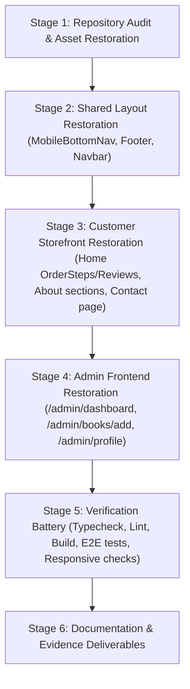

# Phase 05 — Initial Repository Audit & Baseline Report

**Project:** MD Shakib Islamic Books  
**Phase:** 05 — Complete Frontend & Content Parity  
**Repository:** `MD-Shakib`  
**Branch:** `new-fix`  
**Baseline HEAD Commit:** `f6cb4dad08845f63f5fb6ac1867c8ea211d6ec50`  
**Working Tree Status:** Clean  
**Date:** November 2, 2026  
**Lead Architect:** Principal Frontend Architect, Next.js Engineer & QA Specialist  

---

## 1. Executive Summary

Phase 05 establishes complete frontend, content, route, asset, and interaction parity between the legacy React/Vite single-page application (`client/`) and the target Next.js App Router implementation (`apps/web/`).

Following the conditionally verified completion of Phase 04 (Backend & Database Integrity), Phase 05 focuses exclusively on user interface fidelity, missing route restoration, component parity, mobile responsiveness, and end-to-end user experience preservation.

This initial audit establishes the verified repository baseline, enumerates all legacy routes and assets, maps discrepancies, and lays out a staged restoration strategy.

---

## 2. Repository & Architecture Baseline

### 2.1 Git State
- **Active Branch:** `new-fix`
- **Initial HEAD Commit:** `f6cb4dad08845f63f5fb6ac1867c8ea211d6ec50`
- **Working Tree State:** Completely clean prior to Phase 05 activities.
- **Git Safety Protocol:** Strictly adhered to. No `git reset`, `git switch`, `git checkout`, `git clean`, `git stash`, `git rebase`, `git commit`, or `git push` commands will be executed.

### 2.2 Framework & Directory Topology
| Role | Location | Framework & Stack | Build Tool |
|---|---|---|---|
| **Legacy Reference Frontend** | `client/` | React 19, React Router v7, Redux Toolkit, Tailwind CSS v4, Axios | Vite 7 |
| **Target Migrated Frontend** | `apps/web/` | Next.js 16 (App Router), React 19, Supabase SSR, Tailwind CSS v4 | Next.js / Turbopack |
| **Backend & Stored Procedures**| `supabase/` | PostgreSQL 15+, Supabase RLS, Stored Procedures, Migrations | Supabase CLI |
| **Legacy Express API** | `server/` | Node.js, Express, MongoDB (historical reference) | Node |

---

## 3. Route Discovery & Quantification

### 3.1 Legacy Route Inventory
An exhaustive audit of `client/src/routes/AppRoutes.jsx`, `client/src/App.jsx`, and `client/src/components/Footer.jsx` identified **27 distinct routes**:

- **Customer-Facing & Public Routes (19):**
  1. `/` — Home Page
  2. `/books` — Books Catalog & Search
  3. `/books/:id` — Book Details Page
  4. `/about` — About Us
  5. `/support` — Support & FAQ
  6. `/contact` — Contact Support (linked in Footer)
  7. `/cart` — Shopping Cart
  8. `/checkout` — Checkout & Payment
  9. `/order-success` — Order Confirmation
  10. `/orders` — Customer Order History
  11. `/orders/:id` — Customer Order Details
  12. `/profile` — Customer Profile
  13. `/addresses` — Customer Saved Addresses
  14. `/login` — Customer Sign-In
  15. `/register` — Customer Registration
  16. `/verify-email` — Email Verification
  17. `/verify-registration-otp` — Registration OTP Verification
  18. `/forgot-password` — Password Recovery Request
  19. `/verify-otp` — Reset Password OTP Verification
  20. `/reset-password` — Password Reset
  21. `/privacy-policy` — Privacy Policy (footer linked)
  22. `/terms` — Terms of Service (footer linked)

- **Admin Routes (7):**
  23. `/admin` — Admin Dashboard
  24. `/admin/dashboard` — Admin Dashboard alias (routed by MobileBottomNav)
  25. `/admin/books` — Catalog & Inventory Management
  26. `/admin/books/add` — Dedicated Add New Book Page
  27. `/admin/orders` — Orders Moderation & Lifecycle
  28. `/admin/users` — Customer Management & Moderation
  29. `/admin/profile` — Admin Profile, Security & Session Management

### 3.2 Target Next.js Route Inventory
The target application in `apps/web/app/` currently has **49 routes** (including API endpoints, expanded customer account subsystems `/account/*`, and new admin modules `/admin/categories`, `/admin/discounts`, `/admin/inventory`, `/admin/reviews`, `/admin/audit-logs`).

### 3.3 Discrepancies & Gap Quantification
- **Missing Legacy Routes (4):**
  1. `/contact` — Returns 404 in Next.js (linked in footer).
  2. `/admin/dashboard` — Returns 404 in Next.js (referenced by admin bottom nav).
  3. `/admin/books/add` — Returns 404 in Next.js (legacy standalone add-book form).
  4. `/admin/profile` — Returns 404 in Next.js (legacy admin profile/security manager).
- **Partially Implemented Pages (2):**
  1. `/` (Homepage): Missing `OrderSteps` ("How To Order" 4-step sequence) and `Reviews` ("What Our Customers Say" customer reviews).
  2. `/about` (About Page): Missing 5 narrative sections (Islamic Hadith Quote, "Why Choose Us", "Our Values", "Message From The Founder", and "Start Your Journey of Knowledge" CTA).
- **Missing Global Components (1):**
  1. `MobileBottomNav` — Fixed bottom navigation bar for mobile viewport (`md:hidden`), providing thumb-zone access to Home, Books, Cart, Orders, and Profile (or Admin Dashboard, Books, Orders, Users, Profile).
- **Missing Assets (1):**
  1. `logo.png` — Present in `client/public/logo.png` but absent from `apps/web/public/`.

---

## 4. Key Findings by Dimension

### 4.1 Global Layout & Navigation
- The desktop `Navbar` is functional and correctly connected to Supabase Auth and `CartContext`.
- The `Footer` is missing the `/contact` link (currently rendering `/support` twice or leaving contact off).
- The mobile viewport is missing the persistent bottom navigation bar (`MobileBottomNav.jsx`), creating a significant mobile usability degradation compared to legacy.

### 4.2 Content & Storefront
- The legacy Homepage prominently featured:
  - Trust Indicators
  - Featured Book Carousel/Grid
  - "How To Order" 4-step sequence
  - Customer Testimonials / Reviews
  The current Next.js homepage omitted the OrderSteps and Reviews sections entirely.
- The legacy About page featured comprehensive brand storytelling and Islamic literature values, which were truncated in the Next.js version.

### 4.3 Administrator Operations
- While Phase 02 created `/admin/books`, `/admin/orders`, `/admin/users`, `/admin/categories`, `/admin/inventory`, `/admin/reviews`, `/admin/discounts`, and `/admin/audit-logs`, it omitted the legacy direct `/admin/books/add` route, `/admin/dashboard` alias, and `/admin/profile` administrator security page.

---

## 5. Recommended Staged Restoration Plan

1. **Stage 1 — Assets & Foundation:**
   - Copy `client/public/logo.png` to `apps/web/public/logo.png` and configure favicon.
   - Establish Phase 05 documentation baseline.
2. **Stage 2 — Shared Layout & Navigation:**
   - Implement `MobileBottomNav.tsx` in `apps/web/components/layout/MobileBottomNav.tsx`.
   - Update `apps/web/app/layout.tsx` to include `MobileBottomNav` with safe mobile padding (`pb-[70px] md:pb-0`).
   - Update `Footer.tsx` to include `/contact` and clean link targets.
3. **Stage 3 — Customer Storefront Restoration:**
   - Implement `OrderSteps.tsx` and `Reviews.tsx` components.
   - Restore `OrderSteps` and `Reviews` to `apps/web/app/page.tsx`.
   - Restore 5 omitted sections to `apps/web/app/about/page.tsx`.
   - Create `apps/web/app/contact/page.tsx`.
   - Add delivery badge and trust indicators to `apps/web/app/books/[id]/BookDetailClient.tsx`.
4. **Stage 4 — Admin Modules Restoration:**
   - Create `apps/web/app/admin/dashboard/page.tsx` (route alias for `/admin`).
   - Create `apps/web/app/admin/books/add/page.tsx` (dedicated Add Book form).
   - Create `apps/web/app/admin/profile/page.tsx` & `AdminProfileClient.tsx` (admin profile management).
5. **Stage 5 — Comprehensive Verification:**
   - TypeScript compilation (`tsc --noEmit`).
   - ESLint validation.
   - Production Next.js build (`next build`).
   - Automated regression test execution.
   - Responsive & accessibility verification.

